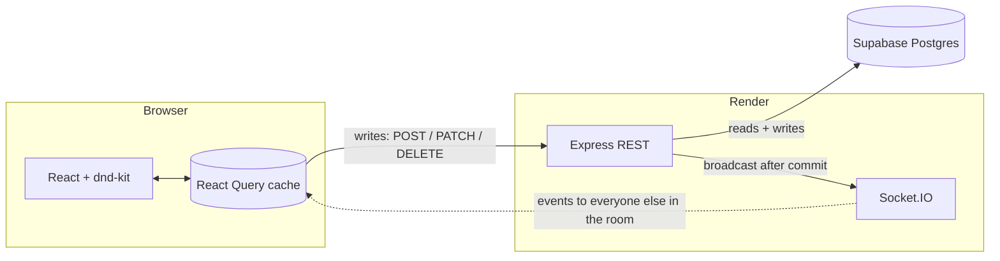

# Kanban

A real-time collaborative Kanban board. Open the same board in two browsers and
every change — dragging a card, renaming one, adding a column — appears in the
other within milliseconds, alongside avatars of whoever else is currently
looking at it.

**[Live demo](https://kanban-lac-chi.vercel.app)** · sign in as `alice` / `password123`, and as `bob` / `password123` in a second browser to see the two sides sync.

> The API is on Render's free tier and sleeps after 15 minutes idle. The first
> request takes up to a minute; the app shows a counter while it wakes.

<!-- TODO: add a GIF of two windows syncing. Record at ~1200px wide, 15-20s:
     drag a card in window A, add a card in window B, show the avatars. -->

---

## What it does

- **Drag and drop** cards within and between columns, with a live preview as you drag
- **Everything syncs** — create, rename, delete, move, add a column
- **Presence** — avatars of everyone currently viewing the board
- **Accounts** — register and sign in; boards belong to people
- **Sharing** — a board owner invites others by username; members can edit, only the owner can invite

## Architecture



**Writes go over REST, changes come back over WebSocket.** A mutation is an
ordinary HTTP request; once it commits, the server broadcasts the change to
everyone else viewing that board. The client that made the change is excluded
from its own broadcast — it already applied the change locally, and echoing it
back would fight with its in-flight mutation.

One room per board (`board-<uuid>`), so a change only reaches people looking at
that board.

### The part worth reading

Remote events and local edits converge on the same pure functions:

```
boardOps.ts          moveCardInBoard, addCardToBoard, renameCardInBoard, …
   ↑                      ↑
local mutation       incoming socket event
(queries/card.ts)    (realtime/useBoardRealtime.ts)
```

Both paths call the identical helper to rewrite the React Query cache, so a
card moved by someone else takes exactly the code path as one you moved
yourself. The helpers are idempotent, so a re-delivered event can't duplicate a
card.

## Decisions, and why

**REST for writes, sockets for fanout.** Doing mutations over the socket would
mean reinventing status codes, validation errors and retries. HTTP already has
those. The socket does the one thing HTTP is bad at: pushing to other people.

**A `BoardMember` join table, not an array of user ids on the board.** Postgres
would happily store `String[]`, but the ORM has no filter for array columns —
"boards I can see" is the app's most-run query and would drop to raw SQL. A
join table also gets foreign keys (delete a user, memberships cascade), atomic
inserts instead of read-modify-write, and somewhere to put a role later.

**Unauthorised boards answer 404, not 403.** "This exists but isn't yours"
confirms a board id is real. A board you can't see is indistinguishable from
one that doesn't exist.

**The socket handshake is authenticated, and joining a room is checked
separately.** Everyone in a room receives every change to that board, so
authenticating the connection isn't enough — `join-board` re-checks membership
against the database, or any signed-in user could watch any board.

**Presence is derived from the room, not tracked beside it.** Socket.IO already
knows who is in `board-<id>`; a parallel `Map` could drift out of sync with
reality. Deduplicated by user id, so two tabs are one person. The full list is
broadcast each time rather than join/leave deltas — a delta stream must arrive
in order with no gaps, while a full list makes a reconnecting client instantly
correct.

**Positions are a dense `1..n` sequence per column.** Moves rebuild the
affected columns' order completely rather than doing gap arithmetic. That's
O(n) writes per move — fine at board scale, and it leaves no room for the
drifting or duplicate positions that gap schemes accumulate. Keeping that
invariant true under concurrency needed row locks; see *Concurrency and
failure*.

**Both auth paths confirm the user still exists.** A valid signature proves a
token was issued, not that the account is still there. Without the check, a
token for a deleted user reaches the database and fails as a foreign key
violation — a 500 where it should be a 401.

## Stack

| | |
|---|---|
| Frontend | React 19, TypeScript, Vite, React Query, dnd-kit, Zustand, Socket.IO client |
| Backend | Node, Express 5, Socket.IO, Prisma 8, Zod, bcrypt, JWT |
| Database | Postgres (Supabase) |
| Hosting | Vercel (frontend) · Render (API) |

## Running locally

Needs Node 20+ and a Postgres database.

```bash
# API
cd backend
cp .env.example .env          # set DATABASE_URL and JWT_SECRET
npm install
npm run contract:emit         # generate the typed Prisma client
npx prisma db update          # create the tables
npm run seed                  # alice + bob, one shared board, one private
npm run dev                   # :3000

# Web
cd frontend
npm install
npm run dev                   # :5173, talks to :3000 by default
```

`npm run seed` is re-runnable — it clears everything first.

### Environment

**backend/.env**

| | |
|---|---|
| `DATABASE_URL` | Postgres connection string |
| `JWT_SECRET` | 32+ characters |
| `CORS_ORIGINS` | comma-separated origins. Optional locally; **required** in production, and the server refuses to start without it |
| `JWT_EXPIRES_IN` | default `7d` |
| `PORT` | default `3000` |

**frontend/.env**

| | |
|---|---|
| `VITE_API_URL` | API base URL. Defaults to `http://localhost:3000`. Compiled into the bundle at build time, so changing it needs a rebuild |

## API

All board routes need `Authorization: Bearer <token>`.

| | |
|---|---|
| `POST /auth/register` · `POST /auth/login` | `{ token, user }` |
| `GET /auth/me` | confirms a stored token is still valid |
| `GET /board` · `POST /board` | boards you own or belong to |
| `GET /board/:id` | board with columns and cards |
| `GET /board/:id/members` · `POST /board/:id/members` | invite is owner-only |
| `POST /column` | |
| `POST /card` · `PATCH /card/:id` · `PATCH /card/:id/move` · `DELETE /card/:id` | |
| `GET /ready` | readiness probe |

Socket events (server → client): `card-created`, `card-updated`, `card-deleted`,
`card-moved`, `column-created`, `presence`.

## Deploying

The repo is a monorepo; both platforms build from a subdirectory.

**Render** (API) — a `render.yaml` blueprint is included. Root directory
`backend`, build `npm ci --include=dev && npm run build`, start `npm start`,
health check `/ready`. Set `DATABASE_URL`, `JWT_SECRET` and `CORS_ORIGINS`
in the dashboard.

**Vercel** (web) — root directory `frontend`, and set `VITE_API_URL` to the
Render URL.

Then set `CORS_ORIGINS` to the Vercel origin, with no trailing slash.

### Two things that will bite

`--include=dev` in the build command is required: `NODE_ENV=production` makes
npm skip devDependencies, and `tsc` is one of them.

The readiness probe is `/ready`, not `/health`, because EasyPrivacy ships the
rule `||onrender.com/health` — Brave, uBlock Origin and AdGuard block that path
on every Render host, so the request never leaves the browser.

## Concurrency and failure

Two people editing the same board at the same time is the normal case here, not
an edge case. What that means in practice:

**Conflicts are last-write-wins, and that is a choice.** Moves, renames and
deletes are small whole-value writes; the second one to commit wins and is
broadcast, so everyone converges on the same state. Operational transforms or
CRDTs buy per-character merging that a board of short card titles doesn't need.

**Per-column row locks keep the ordering sane.** Positions are a dense `1..n`
sequence maintained by read-then-write — count siblings, compute a position,
write. Under concurrency that interleaves badly. Measured, before locking:
eight simultaneous creates in one column produced positions
`[1,2,3,3,5,5,5,5,5,5]`, two users moving the same card left a column with no
position `1`, and a move racing a delete returned a 500.

Every mutation now takes `SELECT … FOR UPDATE` on the owning column before
reading the order it is about to rewrite, one row at a time in sorted id order
so two transactions can't deadlock taking the same pair in opposite order. The
operation then **re-reads the card under the lock** — the first read happened
before the lock and may already be stale, and renumbering the column a card
*used* to be in is what left gaps. Racing deletes now return 404, not 500.

These are covered by a concurrency suite that asserts the invariants after each
race: no card in two places, no duplicate positions, dense `1..n` throughout.

**Reconnects resync by refetching.** A reconnect is a new connection, and while
the socket was down this tab was not in the room — so every broadcast in that
window was simply never delivered, and nothing retries them. Re-joining
restores the feed but not the gap, so the client refetches the board on
reconnect. It's the one case where the full fetch is the cheap answer.

**Failed mutations self-heal.** Every mutation ends with
`invalidateQueries`, so an optimistic update that the server rejects is
corrected by the refetch rather than needing an explicit rollback.

### What I'd do at scale

- **More than one server process** needs the Socket.IO Redis adapter. Rooms are
  per-process today, so two instances would each broadcast to only their own
  half of the viewers. Presence has the same constraint for the same reason —
  it reads the in-memory adapter — but rooms break first.
- **Hot columns** would make a per-column lock the bottleneck, since every
  write to a column serialises. Fractional or lexicographic ranks (insert
  *between* two neighbours, no renumbering, no lock) remove it at the cost of
  keys that drift and need periodic compaction. Worth it only when contention
  is measured, not assumed.
- **O(n) writes per move** is fine for a column of 50 and wrong for 5,000. Same
  fix as above.
- **Horizontal scale** also wants the broadcast decoupled from the request — a
  queue or `LISTEN/NOTIFY` between the write and the fanout, so a slow socket
  layer can't slow a write.

## Known limitations

- **Hand-rolled routing.** The selected board lives in component state, so
  boards aren't linkable and a refresh returns you to the list.
- **Membership changes aren't pushed.** Being added to a board shows up on the
  next refetch rather than instantly; that needs a per-user room, since the
  invitee isn't in the board's room yet.
- **The database certificate isn't verified** — the connection is encrypted but
  uses `sslmode=require` with libpq semantics.
